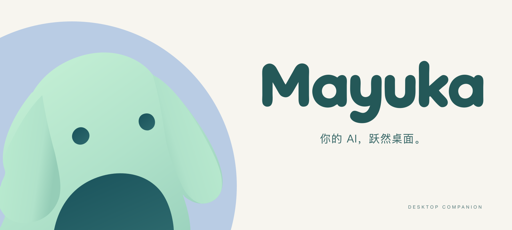
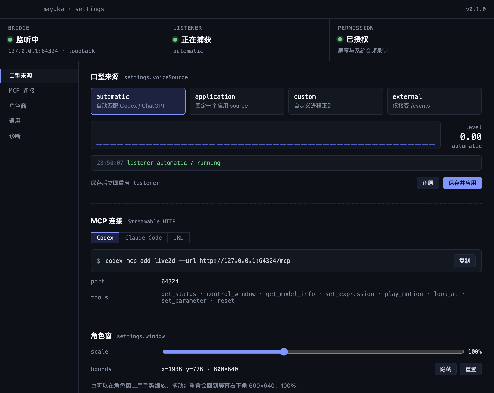
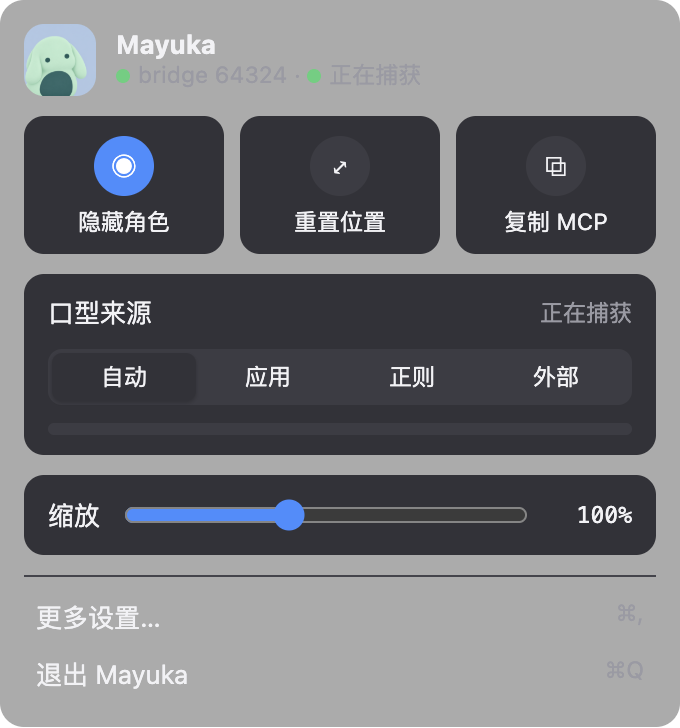

<picture>
  <source media="(prefers-color-scheme: dark)" srcset="./docs/assets/mayuka-banner-dark.svg">
  <source media="(prefers-color-scheme: light)" srcset="./docs/assets/mayuka-banner-light.svg">
  
</picture>

<p align="center"><strong>English</strong> · <a href="./README.zh-CN.md">简体中文</a></p>

# Mayuka

**Your AI, brought to life on your desktop.**

Mayuka is a Live2D desktop companion for the AI tools you already use. Let a character accompany Codex, ChatGPT, and other agents: its mouth follows application audio, while MCP gives your agent control over expressions, motions, gaze, and the character window.

Built with Electron, PixiJS, and Live2D Cubism. Native application-audio capture currently targets **macOS 14.2+**; Windows and Linux can use external voice events, with native capture not yet implemented.

## See it in action

<table>
  <tr>
    <th width="68%">Settings</th>
    <th width="32%">Tray quick controls</th>
  </tr>
  <tr>
    <td valign="top"></td>
    <td valign="top"></td>
  </tr>
</table>

Captured from the running macOS application. The current application interface is in Chinese.

## What Mayuka does

- **A character beside your work.** A transparent, always-on-top Live2D window with controls for moving, scaling, and locking the character.
- **Lip sync from your AI's audio.** Follow a matching process automatically, select an application source, match a custom process pattern, or send external audio-level events.
- **Expression and motion through MCP.** Let an agent discover the model's capabilities, change expressions, play motions, and control its gaze or parameters.
- **Quick access from the tray.** Show or hide the character, reset its position, change voice sources, adjust scale, and copy the MCP connection command.

Mayuka provides visual companionship. It does not synthesize or play speech, use the microphone, or save or upload audio. Its bridge listens only on `127.0.0.1`.

## Quick start

### 1. Install dependencies

You need [Bun](https://bun.sh) **1.1+** and **Node.js 20+**.

```bash
bun install
```

### 2. Add Cubism Core and a model

Cubism Core and character assets are not included in the repository. Obtain them separately and place them under `renderer/public/`.

1. Get `Core/live2dcubismcore.min.js` from the [Cubism SDK for Web](https://www.live2d.com/download/cubism-sdk/download-web/) and copy it to `renderer/public/`.
2. Add a Cubism 3, 4, or 5 model, including its `.moc3`, textures, motions, expressions, and other referenced files. The default loader expects the DeepSeek “大肥鱼” model at the path below.

```text
renderer/public/
├── live2dcubismcore.min.js
└── model/
    └── DeepSeek/
        ├── 大肥鱼.model3.json
        └── …
```

Use **Core 5.x from Cubism 5 SDK 5-r.4 or earlier**. The current renderer uses `untitled-pixi-live2d-engine` with PixiJS v8 and Cubism 5 Framework; Core 6.x from SDK 5-r.5 onward is not compatible with this integration.

To use a different model, update `MODEL_PATH` in [`renderer/src/live2d-app.ts`](renderer/src/live2d-app.ts) and the parameter mappings in [`renderer/src/model-config.ts`](renderer/src/model-config.ts). Missing assets produce setup guidance in the character window.

### 3. Launch Mayuka

Development, with Vite and Electron:

```bash
bun run dev
```

Or build and run the production renderer:

```bash
bun run build
bun start
```

After adding or changing model assets, rebuild before using `bun start`.

Click the tray icon to open quick controls, then **更多设置…** (“More settings”) for the full settings window. Right-click the tray for its context menu; Linux uses that menu directly. Closing the character window hides it while the tray and MCP bridge stay available. Choose **退出 Mayuka** (“Quit Mayuka”) to exit.

Window position, size, and scale are saved in Electron's `userData/settings.json`. Lock state resets on launch. **Reset position** restores a 600 × 640 window at the bottom right and 100% scale.

### 4. Connect your agent

With Mayuka running, register its local MCP endpoint:

```bash
# Codex
codex mcp add live2d --url http://127.0.0.1:47832/mcp

# Claude Code
claude mcp add --transport http live2d http://127.0.0.1:47832/mcp
```

Other clients that support Streamable HTTP MCP can connect to the same URL. Settings shows the actual listening port and provides copyable commands.

For a different bridge port:

```bash
LIVE2D_BRIDGE_PORT=49000 bun run dev
codex mcp add live2d --url http://127.0.0.1:49000/mcp
```

## Voice sources

Choose a source from the tray panel or settings. Valid changes apply immediately and restart the listener; invalid input leaves the last valid configuration intact.

| Mode | Behavior | Required fields |
| --- | --- | --- |
| `automatic` | Match Codex / ChatGPT / OpenAI process names by default. | None |
| `application` | Follow one application source. | `source_id`, `source_name` |
| `custom` | Match processes with a regular expression. | `process_pattern`, at most 200 characters |
| `external` | Disable native capture and consume local `POST /events` messages. | None |

On macOS, native capture requires **System Settings → Privacy & Security → Screen & System Audio Recording** permission for the host running Electron. Settings includes a permission shortcut. Denied permission is reported as `permission-denied`; a missing or unusable helper is reported as `unavailable`.

You can use `external` mode while native capture is unavailable. To rebuild the macOS universal helper, install the Xcode command line tools and run:

```bash
bun run build:native
```

### External events

Select `external` in settings, then send state and normalized audio levels to the bridge:

```bash
# Check the running bridge.
curl --noproxy '*' -s http://127.0.0.1:47832/health

# Tell the companion that the agent is speaking.
curl --noproxy '*' -s -X POST http://127.0.0.1:47832/events \
  -H 'content-type: application/json' \
  -d '{"type":"state","state":{"phase":"active","activity":"speaking"}}'

# Send an audio level between 0 and 1; send 0 for silence.
curl --noproxy '*' -s -X POST http://127.0.0.1:47832/events \
  -H 'content-type: application/json' \
  -d '{"type":"audio-level","level":0.8}'
```

## MCP tools

| Tool | Purpose |
| --- | --- |
| `get_status` | Inspect the window, bridge, voice listener, and model readiness. |
| `control_window` | Show, hide, or toggle the character window. |
| `get_model_info` | List the model's expressions, motion groups, and parameters. |
| `set_expression` | Select an expression. |
| `play_motion` | Play a motion from a model motion group. |
| `look_at` | Set the character's gaze direction. |
| `set_parameter` | Set a Live2D parameter. |
| `reset` | Reset expressions, motions, gaze, and parameters. |

Start with `get_model_info` to discover the names supported by your model. Voice comes from your existing AI tools or external events; Mayuka exposes no TTS tools.

## Configuration

Settings are stored in Electron's `userData/settings.json`. Environment variables override saved voice settings for the current process. The UI indicates when an override is active; remove it and restart to use the saved values.

| Variable | Purpose |
| --- | --- |
| `LIVE2D_BRIDGE_PORT` | Local bridge port; defaults to `47832`. |
| `LIVE2D_VOICE_SOURCE_MODE` | `automatic`, `application`, `custom`, or `external`. |
| `LIVE2D_TARGET_PROCESS_PATTERN` | Override the automatic match or supply the custom regular expression. |
| `LIVE2D_VOICE_SOURCE_ID` | Application source ID. |
| `LIVE2D_VOICE_SOURCE_NAME` | Application display name. |
| `LIVE2D_NATIVE_HELPER_PATH` | Override the native helper path. |
| `LIVE2D_LISTENER_DEBUG=1` | Log listener protocol diagnostics, without audio contents. |
| `LIVE2D_UI_CHROME=1` | Show the character window's status bar and debug panel. |
| `LIVE2D_DEVTOOLS=1` | Open DevTools and show the character window's debug UI. |
| `LIVE2D_RENDERER_LOG=1` | Forward renderer console messages to the terminal. |
| `VITE_DEV_SERVER_URL` | Override the development renderer URL, for example `http://127.0.0.1:5174/`. |

The character normally appears without status or debug bars. You can also enable them with `?debug=1`, `?ui=1`, or `localStorage.setItem('live2d.uiChrome', '1')` followed by a reload.

## Development

```bash
bun run build
bun run test
```

Use **`bun run test`**, which runs the repository's `node:test` suites. Bare `bun test` uses Bun's separate test runner.

Runtime proof scripts are available for individual integrations:

```bash
bun run proof:f3  # Lip sync
bun run proof:f4  # Local bridge
bun run proof:f5  # MCP
bun run proof:f6  # Voice listener
```

- [Product specification](SPEC.md)
- [Architecture](docs/ARCHITECTURE.md)
- [Application and tray icons](electron/assets/icons/README.md)
- [README banners and demo screenshots](docs/assets/README.md)
